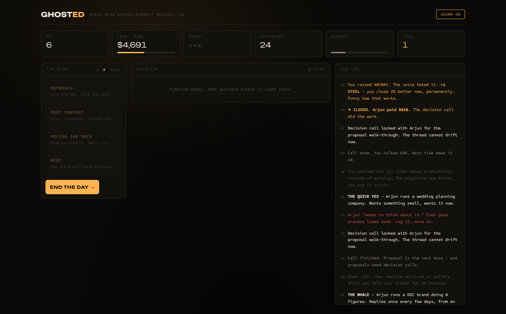

# GHOSTED 👻💼

**An agency simulator. Painfully accurate.**

You have a laptop, an empty pipeline, and a number in your head: **$10,000**. Reach it before burnout reaches you.

**Play:** https://ghosted-game.vercel.app

## The point

Every way a deal dies in this game is a way deals really die - taken from a real agency's pipeline autopsy:

- **The Enthusiast** loves everything and vanishes when money is mentioned
- **The Skeptic** calls your pitch "AI slop" unless you send a working demo first
- **The Negotiator** haggles to a match-point, then evaporates if you leave the thread open
- **The Old Friend** says "100% next week for sure" forever
- A proposal without a scheduled **decision call** quietly dies in three days. Always.

And then there's **the voice**. When you choose to REST, the room dims and it whispers: *"you should be working."* Resting anyway earns **steel** - a permanent close-rate bonus. Giving in buys you one energy now and a bigger burnout bill tomorrow. The optimal strategy in this game is the one hustle culture tells you is losing.

## Verified winnable

The Playwright harness plays a full run with good process (demos for skeptics, decision calls on every proposal, resting through the voice) and wins in ~11 days. Bad process loses. That's not balance tuning, that's the thesis.

## Stack

Plain JS, three modules, zero dependencies, zero build, nothing stored. Synthesized audio (2 AM room tone, pings, the voice's dissonant swell). Seedable RNG (`?seed=42`) for deterministic tests. Open `index.html` to play locally.

---

Built by [Asadulelah](https://github.com/Asadulelah), who has met every single one of these archetypes.
